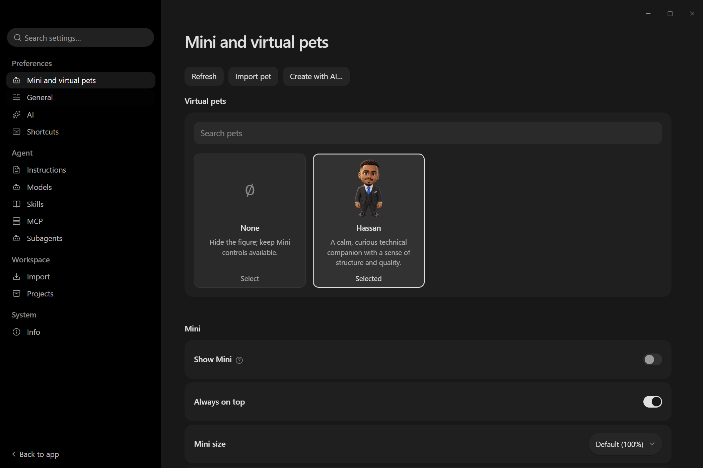
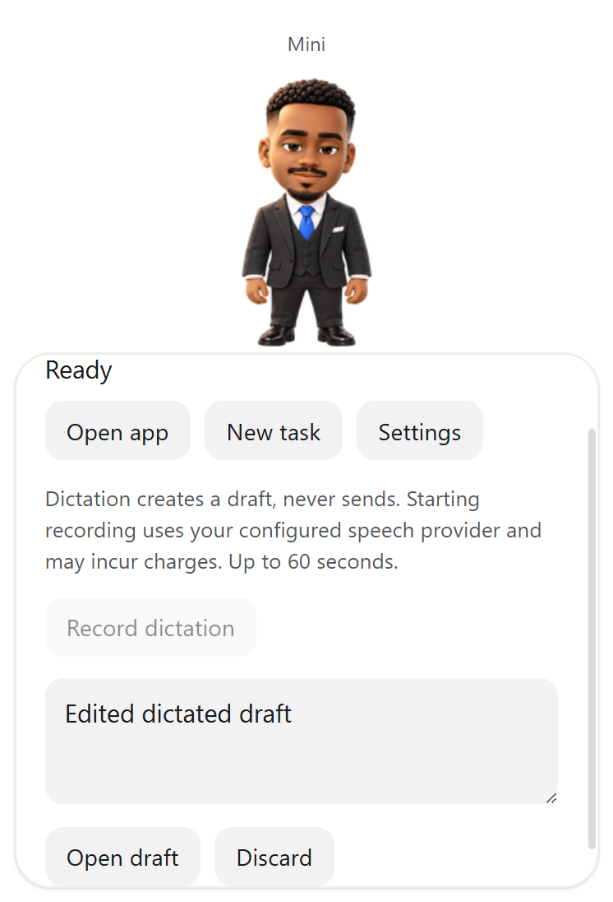
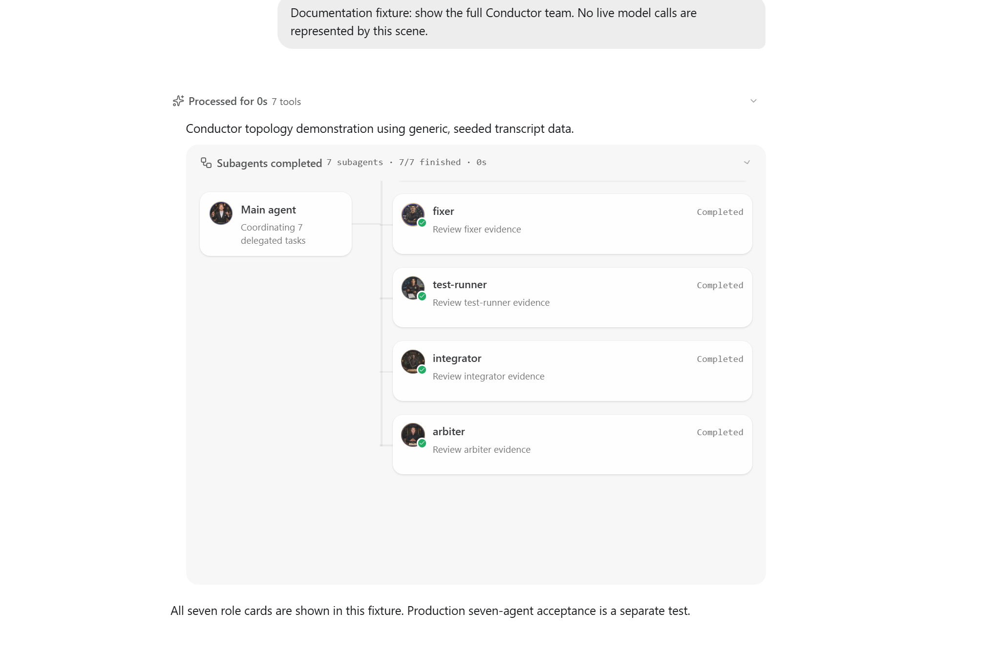
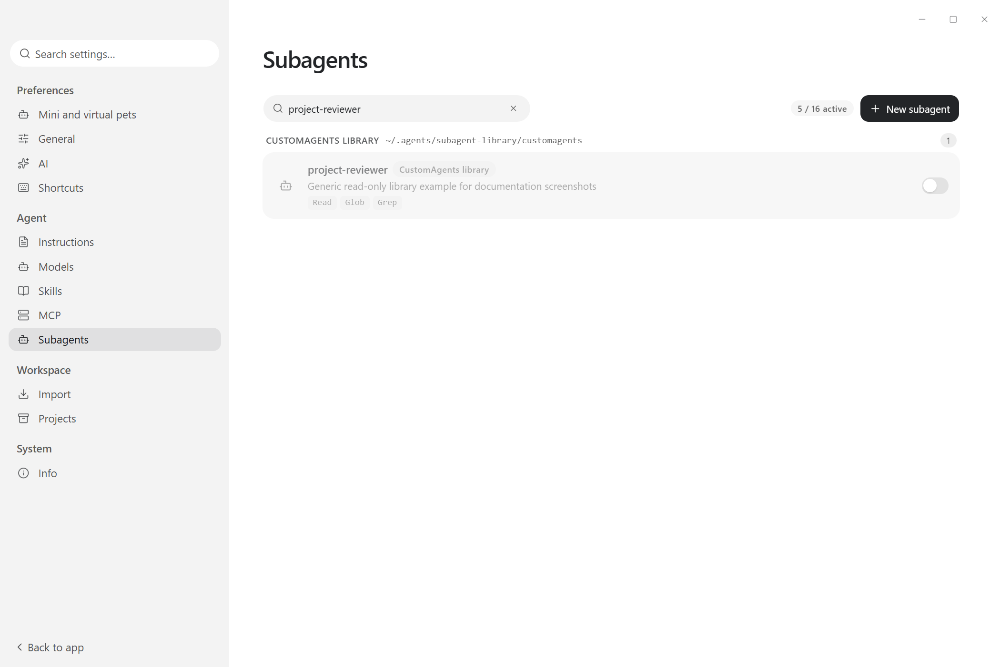

<div align="center">


# Super-Desktop

### Biyocon's local-first AI desktop, built on PI-Desktop

Projects, model providers, tools and delegated agents in one persistent workspace.

[](https://github.com/Biyocon/Super-Desktop/actions/workflows/ci.yml)
[](LICENSE)

[Our additions](#features-added-in-this-fork) · [Screenshots](#screenshots) · [Run from source](#run-from-source) · [Specification](docs/spec/README.md) · [Upstream PI-Desktop](https://github.com/vastsa/PI-Desktop)

</div>

> **Development fork — not an installer release.** The application is named
> **Super-Desktop** (previously Iqra-Desktop). Upstream PI-Desktop installers do
> not include the additions below. Windows candidate checks have been run;
> macOS/Linux support is inherited from upstream, not newly certified here.

## Features added in this fork

| Addition | What is implemented | Where to find it |
|---|---|---|
| **Super-Desktop identity** | Product rename, Biyocon branding and fork-specific assets; technical application IDs remain unchanged. | Application shell and build metadata |
| **Conductor team in chat** | Main coordinator plus seven specialist role portraits. Actual delegated tasks show their status; unused roles remain visible but dimmed. | Expanded delegation group in a conversation |
| **Safe CustomAgents import** | Validated, idempotent import into a separate read-only library, collision/no-clobber protection and qualified library IDs. Existing active registry files are preserved. | `scripts/import-customagents.mjs` and Settings > Subagents |
| **Selectable agent library** | Library agents start disabled and can be selected without overwriting local definitions. The runtime budget is **16 user handles**, with builtins outside that budget. Explicit builtin-off is respected. | Settings > Subagents |
| **Virtual-pet gallery** | Search, bundled owner-supplied Hassan, explicit None, saved choice and animation previews. The welcome figure follows the selected pet. | Settings > Mini and virtual pets |
| **Reviewed pet import** | Native picker, bounded validation, full image decode, preview, explicit confirmation and source-fingerprint revalidation. Imported bytes are copied into application-owned storage. | Import pet |
| **Animated native Mini** | One transparent movable companion, v1/v2 sprite animation, sixteen v2 gaze poses, reduced motion, saved size/topmost/position, configurable shortcut and real selected-session activity. | Show Mini; default `Ctrl+Alt+P` (`Cmd+Alt+P` on macOS) |
| **Draft-only dictation** | Explicit record/stop/cancel, editable transcription and Open draft/discard. Existing composer text is preserved; dictation **never sends automatically**. Reuses existing speech-provider storage. | Mini; provider setup on the Mini/pets Settings page |
| **Confirmed AI pet creation** | Review and separate cost confirmation start a normal agent task with complete v2 package/preview/QA instructions and existing image tools. The result still requires reviewed import. | Create with AI… |

The local source collection used to validate the CustomAgents importer contained
94 profiles. **Those profiles and any associated personal material are not bundled
in this repository.** Use only sources you are authorized to import.

### Conductor roles

| Visual role | Task handle / source |
|---|---|
| Conductor | Main session, not a delegated agent |
| Detective | `explorer` builtin |
| Strategist | `strategist` user definition |
| Devil's Advocate | `code-reviewer` builtin |
| Headsman | `fixer` builtin |
| Auditor | `test-runner` builtin |
| Integrator | `integrator` user definition |
| Arbiter | `arbiter` user definition |

A portrait does not make a role callable: the matching handle must be available.
The graph represents a fan-out group, not a cumulative cross-turn execution graph.
See the [read-only seven-role smoke-test guide](docs/project/conductor-smoke/README.md).

## Screenshots

These are captures of the actual isolated candidate renderer, not generated UI art.
No user conversations, credentials or private agent profiles are shown. Capture
provenance and SHA-256 hashes are listed in
[the screenshot record](docs/image/readme/super-desktop/README.md).

### Pet gallery and persistent preferences



Bundled Hassan, explicit None, import and creation entry points, with native Mini preferences.

### Mini and editable dictation draft



Transcription shown above came from a **loopback speech fixture and external media
fixture**, not a physical microphone. Open draft is explicit and never submits a prompt.

### Conductor team in the conversation



**Seeded transcript fixture, cropped to the chat panel:** the roster contains
seven role cards; this capture shows its visible portion and coordinator. It is
not a claim that seven production-provider agents executed successfully.
The manual/live seven-agent acceptance remains a separate test.

### Read-only agent library



**Generic fixture profile:** illustrates the library controls without publishing
the owner's original CustomAgents content.

## Inherited from upstream

The existing PI-Desktop foundation supplies Agent / Plan / Goal modes, streaming
conversations, persistent local history, multiple model providers, permission-gated
tools, project/file views, plugins, Skills, MCP integrations, Worker Sessions,
image-generation tools and speech services. These are upstream capabilities,
not all newly authored features of this fork.

- [Architecture](docs/spec/02-architecture/01-architecture.md)
- [Plugin development](docs/plugin-development.md)
- [Upstream documentation](https://pi-docs.aiuo.net/)
- [Upstream screenshot guide](docs/guide/screenshots.md)

## Verification and limits

The Mini/pets candidate has host, shared-contract, component, locale and actual
isolated Electron tests. The native harness checks import/restart, narrow preload
permissions, Mini preferences, denied/missing microphone boundary errors,
provider failure/retry, record/cancel/discard and Open draft over existing text
plus an imported attachment without automatic submission. It verifies temporary
audio cleanup, confirmed fixture-task entry and documentation fixture views.
Results identify the candidate/base, screenshot hashes and retained attachment
identity. Physical microphone/provider and generated-pet acceptance stay separate.

```powershell
node scripts/e2e-mini-pets.mjs
```

Build the candidate first. The harness uses separate data/profile/project/agent
paths, loopback speech/model endpoints and external picker/media fixtures.
It must not use your running app or active registry as test data.

**Not claimed:** production speech accuracy, physical microphone acceptance,
paid AI-generated atlas quality, or fresh macOS/Linux native QA. Generated pets
still need owner review of motion previews/contact sheets/QA before import.
A successful task reply alone never installs a pet.

Subagents Settings counts unique active **user handles** across owned and library
definitions; builtins do not consume the 16-user budget. Independent same-role
Conductor Tasks keep separate cards and transcripts; resume chains keep one
current card. `node scripts/e2e-conductor-regressions.mjs` exercises the real
Windows Electron/runtime chain with an external loopback provider fixture:
mouse/Enter/Space, failure/cancellation, in-flight reload and full app restart.
This is not an additional live-model test.

The earlier GIF-only home-mascot experiment is preserved on
[`archive/hassan-home-mascot`](https://github.com/Biyocon/Super-Desktop/tree/archive/hassan-home-mascot).
It is superseded by the selectable atlas-based pet feature and is **not merged over it**.

## Run from source

Use Node.js 24, pnpm 10+ and stable Rust. This is a source-development path, not an
installer or auto-update release.

```powershell
git clone https://github.com/Biyocon/Super-Desktop.git
cd Super-Desktop
pnpm install --frozen-lockfile
cargo build -p host-core --locked
pnpm build:js

# Keep this fork separate from any installed PI-Desktop data and Electron profile.
$data = Join-Path $env:LOCALAPPDATA 'Super-Desktop-dev'
$env:PI_DESKTOP_DATA_DIR = $data
cd apps/desktop
pnpm exec -- electron-vite dev -- "--user-data-dir=$data\electron-profile"
```

The technical application ID is retained for compatibility. Do not point this
checkout at an installed app's data/profile, and never use installed PI-Desktop
host processes as disposable test processes.

## Development checks

```powershell
pnpm --filter @pi-desktop/desktop typecheck
pnpm lint
node scripts/check-architecture.mjs
pnpm -r --if-present test
cargo fmt --all -- --check
cargo clippy --workspace --all-targets --all-features
cargo test -p host-core --locked
```

[Contribution rules](AGENTS.md) · [Mini/pets spec](docs/spec/04-ux/mini-and-virtual-pets.md) ·
[Feature history and delivery notes](docs/project/super-desktop-features.md) ·
[E2E plan](docs/spec/06-delivery/04-e2e-test-plan.md) ·
[Issues](https://github.com/Biyocon/Super-Desktop/issues)

## Upstream credit and license

Super-Desktop is a fork of [vastsa/PI-Desktop](https://github.com/vastsa/PI-Desktop),
built on the [pi ecosystem](https://github.com/badlogic/pi-mono). Original authors'
work and notices remain attributed to them. This README separates Biyocon's fork
additions from that inherited foundation.

The project retains the upstream **LGPL-3.0** license. See [LICENSE](LICENSE).
Hassan is owner-supplied artwork; see its [provenance](crates/host-core/assets/pets/README.md).
No ChatGPT builtin pet gallery or private Pets/Library APIs are included.
